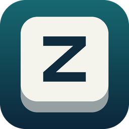
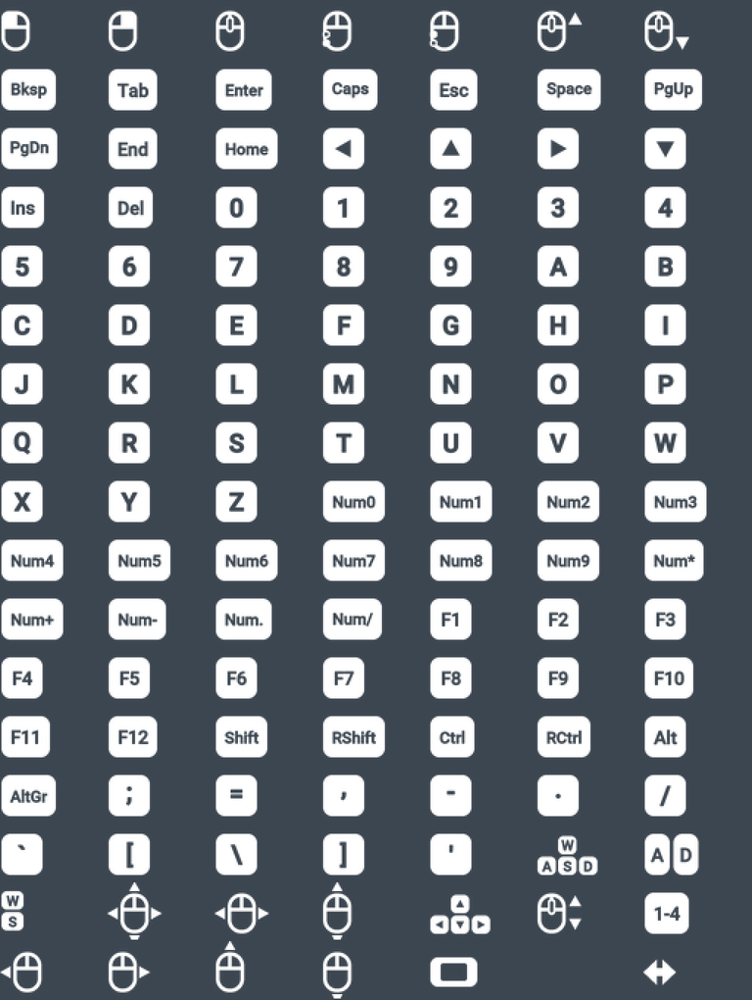

<p align="center"></p>

<h1 align="center">Zelda on PC</h1>

<p align="center">
<b>The Legend of Zelda: Breath of the Wild, set up as a PC game.</b><br>
Mouse and keyboard · PC menus and key prompts · <b>AMD FSR 3 frame generation</b><br>
<i>Runs your own copy of the game on the <a href="https://github.com/cemu-project/Cemu">Cemu</a> emulator.</i>
</p>

---

## It runs on Cemu

Zelda on PC is **not a port and not a recompilation**. It is a fork of [Cemu](https://github.com/cemu-project/Cemu),
the open source Wii U emulator, built to run exactly one game and to make it feel like a native PC release. The
original game code runs inside the emulator, unchanged on disk; everything this project adds sits around it.

**You need your own dump of the game.** No game files, keys or Nintendo code are in this repository or in the
installer, and none are downloaded.

| | Cemu | Zelda on PC |
|---|---|---|
| Start | Emulator window, game list, per-game setup | Double-click, straight into the game |
| Controls | Controller, or keys mapped to controller buttons | Mouse and keyboard made for the game, 1:1 mouse camera |
| On-screen prompts | The buttons of the Wii U GamePad | Your own keys and mouse buttons |
| Menus | Stick and buttons | Mouse: hover, click, drag, wheel |
| Frame rate | FPS++ graphic pack, set up by hand | Built in, **plus AMD FSR 3 frame generation** |
| Settings | Emulator dialogs and graphic packs | One in-game menu (`Esc`) |

## Features

### AMD FSR 3 frame generation

`Esc` → **Graphics** → **Frame Generation** → **AMD FSR 3**.

A generated frame is shown between every two real ones, so 60 rendered frames become 120 displayed ones. This is AMD's
own frame generation (FidelityFX SDK, FSR 3.1) integrated into Cemu's Vulkan renderer. Every frame the emulator hands
it the game's **depth buffer**, **motion vectors** reconstructed from the game camera, and the image **without the
HUD**, so the interface is drawn on top at full sharpness instead of being interpolated.

- The frame rate limit counts the frames you see (limit 120 = 60 real + 60 generated).
- Not tied to a GPU vendor: it runs on the Vulkan renderer.
- Game logic and physics never run on generated frames.
- Like all frame generation it adds about one game frame of input latency. It feels best from 60 real frames upwards.

### Mouse and keyboard, made for this game

- **1:1 mouse camera.** Raw input, no acceleration, no smoothing. The mouse does not pretend to be an analog stick: the
  game's camera code is patched to take the rotation directly, in the third person camera, while aiming the bow, in the
  scope, while climbing and in conversations.
- **Every action rebindable**, two keys per action, with conflict highlighting.
- **Weapons on the mouse wheel**, arrows while aiming. Hold `1` – `4` for the weapon, bow, shield and rune selectors.
- Perfect guard with the attack button while the shield is up, flurry rush with mouse clicks, the jump key closes and
  reopens the paraglider.
- **Motion control shrines with the mouse**: `T` tilts the virtual GamePad.

### Your keys on screen

The game's button prompts show the key or mouse button that is bound to the action, and follow your rebinding. The
glyphs are drawn for this project in the style of the game.

<p align="center"></p>

### A mouse pointer in the game's own menus

- **Inventory:** the selection follows the pointer, click to use an item, click the category icons and the page
  arrows, wheel to change category, drag to rotate Link.
- **Map:** drag to pan, wheel to zoom, click a spot to move the cursor there and confirm (pins, fast travel).
- **Conversations:** click the answer.
- **Adventure Log, title screen, save / load, system menus:** click what you want.

### Plays like a PC game

- Starts directly into the game: no emulator window, no game list, no first-run wizard.
- Borderless fullscreen (`Alt+Enter` toggles a window), cursor captured while playing and released in menus.
- **One settings menu** in the game's style (`Esc`): camera, controls, motion, graphics. It is stored in a readable
  `settings.ini`.
- Resolution from 720p to 4K, frame rate limits from 30 to 240 FPS with corrected game speed and physics, shadows,
  anti-aliasing, V-Sync.
- Inventory, map and Adventure Log open directly on their page (`Tab` / `I`, `M`, `J`).
- Your existing Cemu save is **copied** on the first start. Cemu itself is never changed.
- The window and the shortcuts carry the game's own icon. It is made on your PC from the icon inside your dump; this
  project ships none of the game's artwork.

## Requirements

- Windows 10 or 11, 64-bit.
- A graphics card with Vulkan support. What runs Breath of the Wild well in Cemu runs it well here.
- Your own dump of **The Legend of Zelda: Breath of the Wild** for Wii U, as folders that contain `code`, `content`
  and `meta` (the format [Dumpling](https://github.com/emiyl/dumpling) writes):
  - the base game: Europe, Americas or Japan
  - the **update 1.5.0** (required)
  - the DLC (optional)

Packed formats (`.wua`, `.wud`, `.wux`) are not supported.

## Install

1. Download `ZeldaOnPC-Setup-x.y.z.exe` from the [Releases](../../releases) page, or build it yourself (below).
2. Run it. It asks where to install and **where your game dump is**. Select the folder that holds the base game, the
   update and the DLC, or the base game folder itself; the update and DLC are found next to it or in an existing Cemu
   installation.
3. Start **Zelda on PC** from the Start menu, or from the desktop shortcut if you kept it ticked.

The installer needs no administrator rights and copies nothing from your game folder. Saves and settings live next to
the program (`data` and `settings.ini` in the installation folder); the uninstaller asks before it removes them.

The first minutes after the first start stutter while the emulator compiles the game's shaders. They are cached.

## Controls

All of these are defaults. Change them in `Esc` → **Controls**.

| Action | Key | | Action | Key |
|---|---|---|---|---|
| Move | `W` `A` `S` `D` | | Inventory | `Tab` / `I` |
| Camera | Mouse | | Map | `M` |
| Jump / paraglider | `Space` | | Adventure Log | `J` |
| Sprint / cancel | `Shift` | | PC settings | `Esc` / `F1` |
| Walk | `Ctrl` | | Weapon / bow / shield / rune selector | hold `1` `2` `3` `4` |
| Crouch | `C` | | Next / previous weapon | Mouse wheel |
| Attack | Left mouse | | Menu navigation | Arrow keys, `Enter`, `Backspace` |
| Draw bow | Right mouse | | Motion control (tilt) | `T` |
| Lock on / shield | `Q` / Mouse 4 | | Scope | Middle mouse / `Z` |
| Action / interact | `E` | | Whistle | `X` |
| Use rune | `F` | | Throw weapon | `R` |

Controllers are not handled by this build. For controller play, the game runs just as well in regular Cemu.

## Building from source

You need Windows, [Visual Studio 2022](https://visualstudio.microsoft.com/) or its Build Tools with the *Desktop
development with C++* workload (it brings CMake and Ninja), and Git. For the installer, also
[Inno Setup 6.3+](https://jrsoftware.org/isinfo.php).

```bat
git clone --recursive https://github.com/mircea32000/Zelda-on-PC.git
cd Zelda-on-PC
tools\build.cmd
powershell -ExecutionPolicy Bypass -File tools\package.ps1
```

- `tools\build.cmd` configures and builds `bin\ZeldaOnPC_release.exe`. The first run builds the dependencies through
  vcpkg and takes a while.
- `tools\package.ps1` fetches the two community graphic packs the graphics settings build on, stages the files into
  `build\stage` and compiles `installer\output\ZeldaOnPC-Setup-1.0.0.exe`. `build\stage` is also a complete portable
  copy.

To run straight from the build folder, tell it where the game is in `bin\settings.ini`:

```ini
[Game]
Path=D:\Games\Breath of the Wild
```

More in [docs/DEVELOPMENT.md](docs/DEVELOPMENT.md): how the code is laid out, how the game is patched, the developer
mode and its tools. Cemu's own build notes are in [BUILD.md](BUILD.md).

## How it works

- **A Cemu fork in kiosk mode.** `src/pcedition` is the PC layer; the rest of the tree is Cemu with a few hooks. The
  emulator's interface is still there for debugging: start with `--cemu-ui`.
- **Patches generated at startup.** The game executable (update 1.5.0) is patched in memory through Cemu's graphic
  pack mechanism: camera hooks, menu hooks, prompt hooks. Nothing on disk is modified.
- **The game's interface is read live.** The layouts the game draws are walked every frame, which is how the pointer
  knows what is clickable and how the prompts know which keys to show.
- **Input goes straight to the game.** Raw Input feeds the emulated GamePad directly; Cemu's controller profiles are
  bypassed.
- **Community graphic packs** provide resolution, shadows and the FPS++ frame rate unlock; the settings menu drives
  them.

## Questions

**Is this the game running natively?** No. It is the Wii U game running in Cemu, with a PC layer built around it.

**Does it work with other versions of the game?** Only with update 1.5.0, the last one. The patches are written for
that executable. All three regions use it.

**Can I use my Cemu save?** Yes, it is copied automatically on the first start. Afterwards the two are independent.

**Where is the Cemu window?** Hidden. `ZeldaOnPC.exe --cemu-ui` starts the plain emulator interface.

## Credits and licence

- [Cemu](https://github.com/cemu-project/Cemu) by Team Cemu and its contributors. This project is a fork of it and
  would not exist without it.
- [AMD FidelityFX SDK](https://github.com/GPUOpen-LibrariesAndSDKs/FidelityFX-SDK) for FSR 3 frame generation.
- The [Cemu graphic pack community](https://github.com/cemu-project/cemu_graphic_packs) for the *Graphics* and *FPS++*
  packs.

Licensed under the [Mozilla Public License 2.0](LICENSE.txt), like Cemu. Third-party notices are in
[installer/THIRD-PARTY-NOTICES.txt](installer/THIRD-PARTY-NOTICES.txt).

Zelda on PC is an unofficial fan project. It is not affiliated with, endorsed or sponsored by Nintendo, the Cemu
project or AMD. *The Legend of Zelda* and *Breath of the Wild* are trademarks of Nintendo. Dump your own games.
